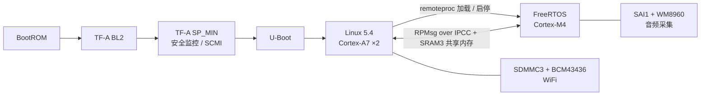

# stm32mp157-sdk

STM32MP157 异构多核（Cortex-A7 ×2 运行 Linux + Cortex-M4 运行 FreeRTOS）的板级支持包：
TF-A / U-Boot / Linux 的板级补丁序列、M4 固件，以及从上电到双核协作的调试记录。

目标板：百问网 100ASK STM32MP157 PRO（板级代码中命名为 `onedots-stm32mp157c-512d`），
另带正点原子 STM32MP157D 的 U-Boot 配置。

## 系统结构



A7 侧 Linux 通过 remoteproc 管理 M4 固件的加载与启停，两核之间用 OpenAMP / RPMsg
（IPCC mailbox 通知 + SRAM3 共享内存）通信。M4 常驻采集音频并跑关键词唤醒（KWS）推理；
唤醒后通过 RPMsg 通知 Linux，并持续转发 PCM 帧，直到 Linux 侧语音识别完成、回送 `ASR_DONE`。

## 我做了什么

所有改动都以补丁序列的形式放在 `patches/`，基于 ST 官方发布 tag，`scripts/fetch-sources.sh` 可以一键复现。

| 组件 | 基线（ST 官方 tag） | 补丁 | 主要内容 |
| --- | --- | --- | --- |
| TF-A | `v2.10-stm32mp-r3` | [5 个](patches/tf-a) | 修复 SP_MIN 未初始化 TAMP NVRAM、导致 Linux 唤醒第二个 A7 核（PSCI CPU_ON）时 Monitor 模式 data abort 的问题；HSE digital bypass 下 HSERDY 不置位的时钟修复；为 M4 remoteproc 实现 MCU_HOLD_BOOT 的 SCMI reset domain；板级 DTS |
| U-Boot | `v2020.01-stm32mp-r2.2` | [5 个](patches/u-boot) | 板级支持；正点原子 STM32MP157D 配置；FIP 变大后 trusted defconfig 的 `ENV_OFFSET` 修正；新版主机工具链下 dtc 的编译修复 |
| Linux | `v5.4-stm32mp-r2.4` | [9 个](patches/linux) | 板级 DTS 与 defconfig；M4 remoteproc（IPCC / RPMsg 保留内存、resource table）；WM8960 声卡（SAI1，SAI1_K 取自 PLL3_Q）；BCM43436 WiFi（bcmdhd） |
| M4 固件 | STM32CubeIDE 工程 | [firmware/m4](firmware/m4) | FreeRTOS + OpenAMP；SAI 音频采集；TFLite Micro 关键词唤醒 |

Linux 补丁 `0006` 是 Broadcom bcmdhd 驱动的原样导入（GPLv2 厂商代码，约 9 MB），
单独成一个补丁，以便和板级集成 `0007` 分开审阅。

## 快速开始

### 1. 获取源码并打补丁

```bash
git clone https://github.com/onedots1014/stm32mp157-sdk.git
cd stm32mp157-sdk
scripts/fetch-sources.sh          # 或单独：linux | u-boot | tf-a
```

脚本会按 ST 官方 tag 浅克隆源码，校验 tag 对应的 commit，然后用 `git am` 打上补丁，
输出到 `sources/<组件>/`。

### 2. 构建

> 统一构建框架（`build.sh` + `board.conf`，覆盖 TF-A / U-Boot / Linux / rootfs / M4 固件）
> 正在从本地开发环境整理迁入，完成后补充到这里。

M4 固件目前可以单独构建（需要 STM32CubeIDE）：

```bash
CUBEIDE_DIR=/opt/st/stm32cubeide_2.1.0 firmware/m4/build.sh
```

## 目录结构

```
stm32mp157-sdk/
├── patches/
│   ├── linux/      9 个补丁，基于 v5.4-stm32mp-r2.4
│   ├── u-boot/     5 个补丁，基于 v2020.01-stm32mp-r2.2
│   └── tf-a/       5 个补丁，基于 v2.10-stm32mp-r3
├── firmware/m4/    Cortex-M4 FreeRTOS 固件（STM32CubeIDE 工程）
├── scripts/
│   └── fetch-sources.sh
└── docs/           调试与根因分析记录
```

## 调试记录

见 [docs/](docs/)。

## 许可证

本仓库混合了多种许可证，详见 [LICENSE.md](LICENSE.md)。简要说明：

- 补丁沿用各自上游项目的许可证（Linux、U-Boot 为 GPL-2.0，TF-A 为 BSD-3-Clause）
- 原创脚本与文档采用 MIT
- `firmware/m4` 中的 ST X-CUBE-AI 运行库（`NetworkRuntime1200_CM4_GCC.a`）适用 ST SLA0104，**不在**本仓库的开源许可范围内
