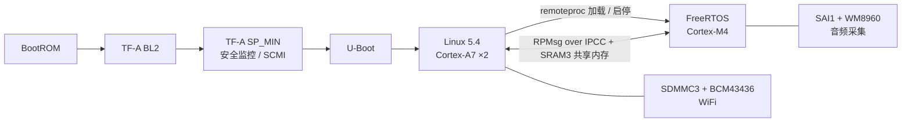

# stm32mp157-sdk

STM32MP157 异构多核（Cortex-A7 ×2 运行 Linux + Cortex-M4 运行 FreeRTOS）的板级支持包：
TF-A / U-Boot / Linux 的板级补丁序列、M4 固件，以及从上电到双核协作的调试记录。

目标板：百问网 100ASK STM32MP157 PRO（板级代码中命名为 `onedots-stm32mp157c-512d`），
另带正点原子 STM32MP157D 的 U-Boot 配置。百问网 100ASK 原厂配置暂未包含。

## 系统结构



A7 侧 Linux 通过 remoteproc 管理 M4 固件的加载与启停，两核之间用 OpenAMP / RPMsg
（IPCC mailbox 通知 + SRAM3 共享内存）通信。M4 常驻采集音频并跑关键词唤醒（KWS）推理；
唤醒后通过 RPMsg 通知 Linux，并持续转发 PCM 帧，直到 Linux 侧语音识别完成、回送 `ASR_DONE`。

## 我做了什么

所有改动都以补丁序列的形式放在 `patches/`，基于 ST 官方发布 tag，`scripts/fetch-sources.sh` 可以一键复现。

| 组件 | 基线（官方 tag） | 补丁 | 主要内容 |
| --- | --- | --- | --- |
| TF-A | `v2.10-stm32mp-r3` | [4 个](patches/tf-a) | 修复 SP_MIN 未初始化 TAMP NVRAM、导致 Linux 唤醒第二个 A7 核（PSCI CPU_ON）时 Monitor 模式 data abort 的问题；HSE digital bypass 下 HSERDY 不置位的时钟修复；为 M4 remoteproc 实现 MCU_HOLD_BOOT 的 SCMI reset domain；板级 DTS |
| U-Boot | `v2020.01-stm32mp-r2.2` | [4 个](patches/u-boot) | 板级支持；正点原子 STM32MP157D 配置；FIP 变大后 trusted defconfig 的 `ENV_OFFSET` 修正；新版主机工具链下 dtc 的编译修复 |
| Linux | `v5.4-stm32mp-r2.4` | [8 个](patches/linux) | 板级 DTS 与 defconfig；M4 remoteproc（IPCC / RPMsg 保留内存、resource table）；WM8960 声卡（SAI1，SAI1_K 取自 PLL3_Q）；BCM43436 WiFi（bcmdhd）；M4 持续采集音频时 CA7 可进入 s2idle 并被 M4 经 RPMsg 唤醒（关键时钟、IPCC wakeup-source、DMA1 归属） |
| BusyBox | `1_37_0` | [1 个](patches/busybox) | 回移上游修复 `bf57f732`：1.37.0 在非 x86 上开启默认的 `SHA1_HWACCEL` 会编译失败（`Upstream-Status: Backport`） |
| M4 固件 | STM32CubeIDE 工程 | [firmware/m4](firmware/m4) | FreeRTOS + OpenAMP；SAI 音频采集；TFLite Micro 关键词唤醒 |

Linux 补丁 `0006` 是 Broadcom bcmdhd 驱动的原样导入（GPLv2 厂商代码，约 9 MB），
单独成一个补丁，以便和板级集成 `0007` 分开审阅。

## 快速开始

### 1. 获取源码并打补丁

```bash
git clone https://github.com/onedots1014/stm32mp157-sdk.git
cd stm32mp157-sdk
scripts/fetch-sources.sh          # 或单独：linux | u-boot | tf-a | busybox
```

脚本会按 [`scripts/sources.list`](scripts/sources.list) 中的官方 tag 浅克隆 ST 的 Linux / U-Boot / TF-A 和 BusyBox 1.37.0，
校验 tag 对应的 commit，再用 `git am` 打上补丁，输出到 `sources/<组件>/`。

**修改补丁**：补丁打上后就是 `sources/<组件>/` 里的普通 git 提交，直接在上面开发，再导回 `patches/`：

```bash
cd sources/linux && <修改> && git commit       # 或 git rebase -i 改标题、拆分、调整顺序
cd ../.. && scripts/export-patches.sh linux    # 重写 patches/linux/，未改动的补丁不会产生 diff
git add patches/linux && git commit
```

`export-patches.sh` 会检查 `sources/<组件>/` 是否基于 `sources.list` 中的 tag、是否有未提交的修改。

### 2. 构建（build.sh）

需要 `arm-linux-gnueabi-gcc` 交叉工具链、`make`、`genext2fs`；构建 M4 固件还需要 STM32CubeIDE。

```bash
./build.sh config                 # 选择板子；只有一块板时可省略，自动选中 onedots_stm32mp157
./build.sh all                    # TF-A → U-Boot → Linux → M4 → FIP → BusyBox → rootfs
./build.sh kernel                 # 也可以单独构建某个模块：atf | uboot | kernel | busybox | rootfs | m4
./build.sh flash full             # 通过 STM32CubeProgrammer 烧写（见 boards/stm32mp157/common/flash/）
```

产物输出到 `output/<板名>/`。`build.sh` 默认从 `sources/` 读取源码，可用 `SRC_DIR` 覆盖。

> M4 固件的代码区（`SRAM1_text`，160 KB）余量很小：用 Ubuntu 的 arm-none-eabi-gcc 13.2 以 `-O0` 编译会超出约 700 字节，
> `-Os` 时约 118 KB。请使用 STM32CubeIDE 自带的工具链；改动较大时注意检查链接结果。

### 3. 仓库里没有、需要自行准备的文件

为避免分发厂商二进制，下列文件没有放进仓库：

| 文件 | 用途 | 放到哪里 |
| --- | --- | --- |
| BCM43436 / AP6236 WiFi 固件（`fw_bcm43436b0.bin`、`brcmfmac43430-sdio.bin`）和蓝牙 `BCM.hcd` | WiFi / BT | `boards/stm32mp157/onedots_stm32mp157/rootfs-overlay/lib/firmware/`（已在 .gitignore 中） |
| ALSA 用户态（`alsa-lib`、`aplay`、`amixer` 等）和 i2c-tools | BusyBox rootfs 下的音频调试 | 运行一次 `bash boards/stm32mp157/onedots_stm32mp157/scripts/setup-audio.sh`，交叉编译后装进 rootfs overlay |
| `stm32wrapper4dbg`（可选） | 生成带调试头的 TF-A 镜像 | 从 [STMicroelectronics/stm32wrapper4dbg](https://github.com/STMicroelectronics/stm32wrapper4dbg) 编译，放到 `boards/stm32mp157/common/build_script/tfa/` |

`rootfs-overlay/etc/wpa_supplicant.conf` 里的 `YOUR_SSID` / `YOUR_PASSWORD` 需改成自己的 WiFi。

### Buildroot（可选）

`boards/stm32mp157/onedots_stm32mp157/buildroot/` 是一个 BR2_EXTERNAL 树，基于 Buildroot 2025.05，
通过 `local.mk` 直接使用 `sources/` 中已打补丁的源码，生成和 `build.sh` 相同的启动链：

```bash
make -C <buildroot> O=$PWD/output/buildroot \
     BR2_EXTERNAL=$PWD/boards/stm32mp157/onedots_stm32mp157/buildroot \
     onedots_stm32mp157_defconfig
make -C output/buildroot
```

`output/buildroot/images/` 中的产物：

| 文件 | 用途 |
| --- | --- |
| `tf-a-onedots-stm32mp157c-evb.stm32`、`fip.bin`、`bootfs.ext4`、`rootfs.ext4` | 烧写 eMMC：`./build.sh flash buildroot`（USB 启动用的 serialboot TF-A 需先 `./build.sh atf` 生成） |
| `sdcard.img` | SD 卡镜像：fsbl1 → fsbl2 → fip → bootfs → rootfs，可直接 `dd` 写卡 |

> 已验证到出镜像这一步：FIP 与 `build.sh` 生成的条目一致，`sdcard.img` 各分区与对应镜像逐字节一致。
> SD 卡启动尚未上板验证。

## 目录结构

```
stm32mp157-sdk/
├── build.sh                  统一构建入口
├── boards/stm32mp157/
│   ├── common/               各组件构建脚本、烧写工具（flash.sh + TSV 布局）
│   └── onedots_stm32mp157/   board.conf、extlinux、rootfs overlay、BR2_EXTERNAL
├── patches/
│   ├── linux/                8 个补丁，基于 v5.4-stm32mp-r2.4
│   ├── u-boot/               4 个补丁，基于 v2020.01-stm32mp-r2.2
│   ├── tf-a/                 4 个补丁，基于 v2.10-stm32mp-r3
│   └── busybox/              1 个上游修复回移，基于 1_37_0
├── firmware/m4/              Cortex-M4 FreeRTOS 固件（STM32CubeIDE 工程）
├── app/                      CA7 侧 KWS 结果侦听脚本、LED 驱动示例
├── tools/kws_training/       唤醒词模型训练流水线（TTS 合成 → 特征 → DS-CNN → 量化 → 导出给 M4）
├── scripts/                  fetch-sources.sh（拉源码 + 打补丁）、export-patches.sh（导回补丁）、sources.list
└── docs/                     调试与根因分析记录
```

## 调试记录

见 [docs/](docs/)。

## 许可证

本仓库混合了多种许可证，详见 [LICENSE.md](LICENSE.md)。简要说明：

- 补丁沿用各自上游项目的许可证（Linux、U-Boot 为 GPL-2.0，TF-A 为 BSD-3-Clause）
- 原创脚本与文档采用 MIT
- `firmware/m4` 中的 ST X-CUBE-AI 运行库（`NetworkRuntime1200_CM4_GCC.a`）适用 ST SLA0104，**不在**本仓库的开源许可范围内
